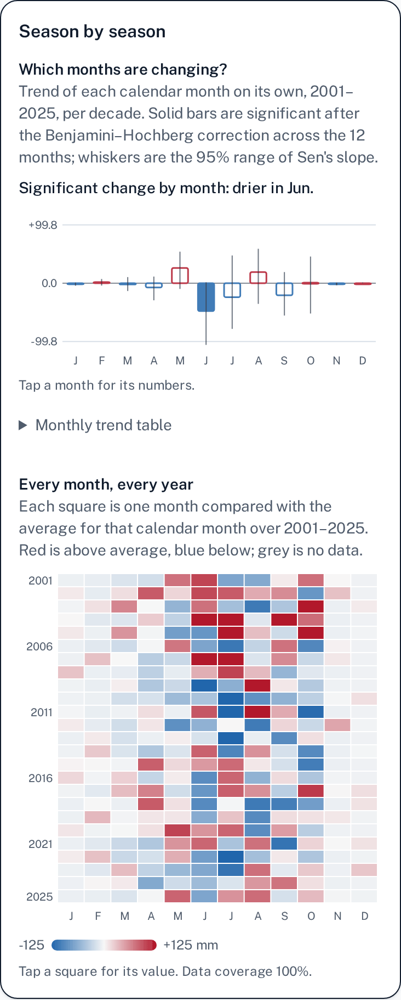
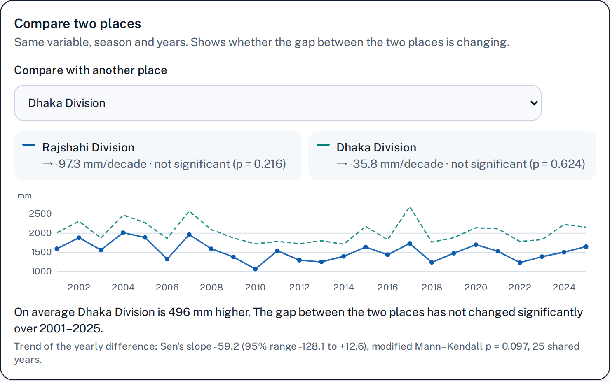
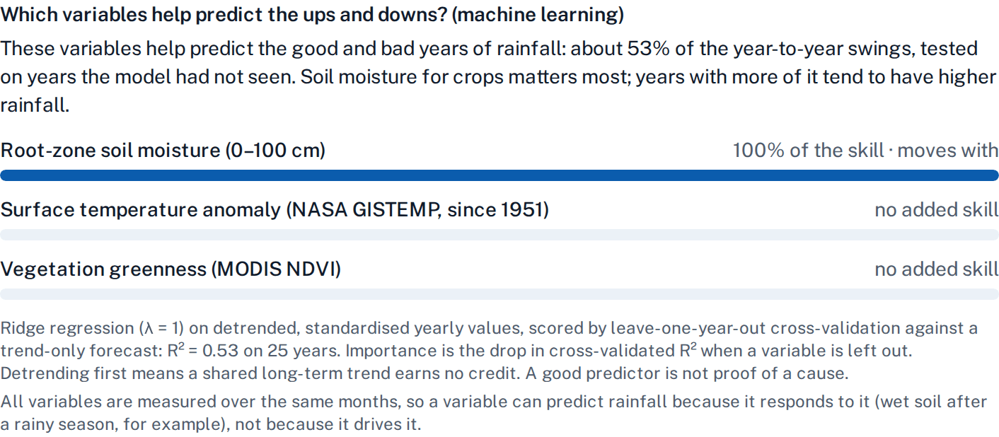

# Earth System Trend Explorer

**by Team DIVERGENT · NASA Space Apps Challenge 2026 · Rajshahi, Bangladesh**

> Find what changes. Understand what matters.

**Demo video:** [watch the 4-minute demo](docs/video/DIVERGENT_demo_video.mp4) (1080p, 3:59)

An evidence-based web app that turns NASA Earth observation records into clear, honest answers about how Earth is changing, for researchers and for farmers, students and citizens alike. It runs fully in the browser: no server, no login, no install.


## The problem

NASA publishes decades of satellite and reanalysis data on temperature, rainfall, soil moisture, vegetation, snow, sea ice and the ocean. But a farmer in Rajshahi, a student or a local official cannot easily answer a simple question with it: _is monsoon rainfall here actually decreasing?_ Raw data portals need expertise and tooling. Simple charts mislead, because climate series are noisy and autocorrelated and datasets disagree. And most tools never say how sure they are.

## Our solution

Pick an **Earth system**, a **variable**, a **region** (from a list or by tapping the map) and a **time period**. The app loads the data, runs a transparent statistical pipeline and answers six questions:

1. **What** is changing?
2. **Where** is it changing? (a grid-cell map of change)
3. **How much?** (Sen's slope per decade, with a 95% interval)
4. **When** did the major change occur? (change point: a jump in level or a change in speed)
5. **Is it significant?** (autocorrelation-corrected Mann–Kendall)
6. **How reliable is it?** (data coverage, record length and agreement with an independent dataset)

Every result is told twice: in **Research** language with every statistic, and in **Everyday** plain English.

## Features

- **5 Earth systems, 21 variables:** Climate, Biosphere, Land Surface, Cryosphere and Ocean, including aerosol haze (AOD at 550 nm).
- **Regions:** all of Bangladesh, its eight divisions, the Sundarbans, the Eastern and Central Himalaya, the Northern and Central Bay of Bengal and the Arctic Ocean, or any point you tap on the map.
- **Seasons:** whole year, pre-monsoon (Mar–May), monsoon (Jun–Sep), post-monsoon (Oct–Nov), winter (Dec–Feb) or any single month; any year range.
- **"How sure are we?" panel:** significance, coverage, dataset agreement and an overall confidence that is never High for a trend that is not significant or that a second dataset contradicts.
- **Second-source check with break detection:** land results are compared with independent NOAA datasets (ERA5 for tapped points). A sudden jump in the gap between the two flags a likely inhomogeneity and lowers confidence.
- **Cross-variable view:** which variables change together, always reported as association, never cause.
- **Season by season:** the trend of every calendar month, corrected for testing twelve months at once (Benjamini–Hochberg), plus a year × month heatmap of differences from each month's average. Rajshahi rainfall: significantly drier in June.
- **Compare two places:** tests whether the gap between two regions is changing, instead of comparing two separate trends. Rajshahi vs Dhaka rainfall: Dhaka averages about 496 mm more a year, and the gap has not changed significantly (2001–2025).
- **Machine-learning view:** an explainable ridge model shows which related variables help predict the good and bad years, scored only on years it never saw, with shared long-term trends removed first. Rajshahi rainfall: about 53% of the year-to-year swings, mostly through soil moisture. It always says that prediction is not cause, and that same-season variables can simply respond to the target.
- **One-page report:** print or save any result as a clean PDF with the link that reopens it.
- **First-visit tour:** three steps that show a new visitor how to ask a question.
- **A farmer's story:** three questions a farmer near Rajshahi asks (monsoon rain, dry-season soil moisture, vegetation), answered from three NASA datasets.
- **Quick-start questions:** "Is Bangladesh getting hotter?", "Is the sea next to us warming?", "How fast is Arctic sea ice shrinking in September?", "Is winter haze over Dhaka getting worse?" and more.
- **Share and export:** every analysis is a shareable link; download the chart as PNG or the numbers as CSV.
- **Mobile first and accessible:** touch charts and maps with 44 px touch targets, tested in real Chrome with phone emulation from 320 to 1366 px plus a landscape phone; dark mode; AA colour contrast in both themes; colour-blind-safe charts; visible keyboard focus; motion that respects the reduce-motion setting.
- **Own design:** NASA blue with a teal accent and the Public Sans typeface (self-hosted).
- **Methods page** with every test, its reference and the app's limits.
- **Live weather map** (the original Open-Meteo map, with NASA GIBS imagery and NASA POWER panels) on its own page.

## Methods

All statistics run in the browser in TypeScript (`src/lib/trend/stats.ts`). The newer views (season by season, compare two places, machine learning) are in `src/lib/trend/insights.ts`. Unit tests check them against the Python reference packages pymannkendall, SciPy and NumPy (`src/lib/tests/trend-stats.test.ts`, `src/lib/tests/trend-insights.test.ts`, reference values from `scripts/insights-reference.py`).

| Question                                         | Method                                                                                                                                              | Reference                                                                                                                 |
| ------------------------------------------------ | --------------------------------------------------------------------------------------------------------------------------------------------------- | ------------------------------------------------------------------------------------------------------------------------- |
| Is there a trend?                                | Mann–Kendall, tie-corrected                                                                                                                         | Mann (1945) _Econometrica_ 13:245; Kendall (1975) _Rank Correlation Methods_                                              |
| ...even with autocorrelation? (primary test)     | Hamed–Rao modified Mann–Kendall                                                                                                                     | Hamed & Rao (1998) _J. Hydrology_ 204:182–196                                                                             |
| Second autocorrelation check                     | Trend-free pre-whitening                                                                                                                            | Yue, Pilon, Phinney & Cavadias (2002) _Hydrol. Processes_ 16:1807                                                         |
| How much per decade?                             | Sen's slope with a 95% interval                                                                                                                     | Sen (1968) _JASA_ 63:1379; Gilbert (1987)                                                                                 |
| When did the level shift?                        | Pettitt change-point test                                                                                                                           | Pettitt (1979) _Applied Statistics_ 28:126–135                                                                            |
| Did the change speed up or slow down?            | Two-phase regression compared by BIC (ΔBIC > 6)                                                                                                     | Schwarz (1978) _Ann. Statist._ 6:461; Kass & Raftery (1995) _JASA_ 90:773                                                 |
| Where is the change real?                        | Per-cell tests with Benjamini–Hochberg FDR                                                                                                          | Benjamini & Hochberg (1995) _JRSS B_ 57:289; Wilks (2016) _BAMS_ 97:2263                                                  |
| Do variables change together?                    | Detrended Pearson with effective sample size, plus Spearman                                                                                         | Bretherton et al. (1999) _J. Climate_ 12:1990                                                                             |
| Is the dataset trustworthy?                      | Agreement with an independent dataset and a Pettitt test on their difference                                                                        | Peterson et al. (1998) _Int. J. Climatol._ 18:1493                                                                        |
| Which months are changing?                       | Per-month Sen's slope and Hamed–Rao Mann–Kendall, Benjamini–Hochberg across the 12 months                                                           | Hamed & Rao (1998); Benjamini & Hochberg (1995)                                                                           |
| Is the gap between two places changing?          | Sen's slope and Hamed–Rao Mann–Kendall on the yearly difference A − B                                                                               | Sen (1968); Hamed & Rao (1998)                                                                                            |
| Which variables help predict good and bad years? | Ridge regression (λ = 1) on detrended, standardised values; leave-one-year-out R² against a trend-only forecast; leave-one-covariate-out importance | Hoerl & Kennard (1970) _Technometrics_ 12:55–67; Stone (1974) _JRSS B_ 36:111–147; Lei et al. (2018) _JASA_ 113:1094–1111 |

**Pipeline:** load monthly values → aggregate to one value per year for the chosen season (a mean needs at least three quarters of its months, a total needs all of them; a missing month is filled with its long-term average plus the season's anomaly so it cannot bias the mean; an unfinished year is left out) → test → judge reliability → explain.

## NASA data

| System       | Variable                                                           | Dataset                                                                  | Resolution                     | Access |
| ------------ | ------------------------------------------------------------------ | ------------------------------------------------------------------------ | ------------------------------ | ------ |
| Climate      | Surface temperature anomaly                                        | [NASA GISTEMP v4](https://data.giss.nasa.gov/gistemp/)                   | 2°, monthly, vs 1951–1980      | Sample |
| Climate      | Air temperature, daily maximum, relative humidity, rainfall        | [MERRA-2 via NASA POWER](https://power.larc.nasa.gov/)                   | 0.5° × 0.625°, monthly         | Live   |
| Climate      | Rainfall (satellite)                                               | [GPM IMERG Final via NASA POWER](https://gpm.nasa.gov/data/imerg)        | 0.1°, daily                    | Live   |
| Climate      | Surface solar radiation                                            | [CERES SYN1deg / GEWEX SRB via NASA POWER](https://power.larc.nasa.gov/) | 1°, monthly                    | Live   |
| Climate      | Aerosol haze (AOD at 550 nm, from 2001)                            | [NASA POWER AOD_55](https://power.larc.nasa.gov/)                        | 0.5° × 0.625°, monthly         | Live   |
| Biosphere    | Vegetation greenness (NDVI)                                        | [MODIS Terra MOD13Q1 v6.1](https://modis.ornl.gov/sites/)                | 250 m, 16-day, division sites  | Sample |
| Biosphere    | Plant productivity (NPP)                                           | [MODIS Terra MOD17A3HGF v6.1](https://modis.ornl.gov/sites/)             | 500 m, yearly, division sites  | Sample |
| Land Surface | Surface and root-zone soil moisture, skin temperature, evaporation | [MERRA-2 via NASA POWER](https://power.larc.nasa.gov/)                   | 0.5° × 0.625°, monthly         | Live   |
| Cryosphere   | Snow cover, snow depth, frost days                                 | [MERRA-2 via NASA POWER](https://power.larc.nasa.gov/)                   | 0.5° × 0.625°, monthly         | Live   |
| Cryosphere   | Arctic sea-ice extent                                              | [NSIDC Sea Ice Index v4 (G02135)](https://nsidc.org/data/g02135)         | 25 km, monthly                 | Sample |
| Ocean        | Sea surface temperature                                            | [MERRA-2 via NASA POWER](https://power.larc.nasa.gov/)                   | 0.5° × 0.625°, monthly         | Live   |
| Ocean        | Sea surface temperature (satellite)                                | [NASA JPL MUR SST v4.1](https://podaac.jpl.nasa.gov/MEaSUREs-MUR)        | 0.01°, monthly, two Bay points | Sample |
| Ocean        | Chlorophyll-a                                                      | [NASA MODIS-Aqua ocean colour](https://oceancolor.gsfc.nasa.gov/)        | 4 km, monthly, two Bay points  | Sample |

**Live** datasets are read from NASA servers in your browser. **Sample** datasets come from servers a web page cannot read (no cross-site access, or too slow), so they were downloaded once with `scripts/fetch-trend-samples.py` and `scripts/fetch-reference.py` and are bundled in `static/trend-samples/`, clearly labelled in the app.

**Dataset references:** GISTEMP v4, Lenssen et al. (2019) _J. Geophys. Res. Atmos._ 124:6307–6326; MERRA-2, Gelaro et al. (2017) _J. Climate_ 30:5419–5454; NSIDC Sea Ice Index v4, Fetterer et al. (2025), doi:10.7265/a98x-0f50; MUR SST v4.1, Chin, Vazquez-Cuervo & Armstrong (2017) _Remote Sens. Environ._ 200:154–169.

**Independent comparison datasets:** NOAA PSL (GHCN_CAMS station temperature, GPCP v2.3 precipitation, CPC soil moisture, NCEP reanalyses) and ECMWF ERA5 via Open-Meteo for tapped points. **Imagery:** NASA GIBS. Built with the Space Apps Bangladesh NASA Data Resource Hub.

## Screenshots

| Phone (390 px)                                          | Farmer story                                       | Dark mode                               |
| ------------------------------------------------------- | -------------------------------------------------- | --------------------------------------- |
|  |  |  |


| Season by season (phone)                                                | Compare two places                                          |
| ----------------------------------------------------------------------- | ----------------------------------------------------------- |
|  |  |



## Run it locally

Requires Node LTS (see `.nvmrc`).

```bash
npm install
npm run dev            # http://localhost:5173
```

Checks and tests:

```bash
npm run lint           # Prettier and ESLint
npm run check          # svelte-check (TypeScript)
npx vitest run         # unit tests
```

Production build for a sub-path (as on GitHub Pages):

```bash
BASE_PATH=/nasa npm run build
BASE_PATH=/nasa npm run preview   # http://localhost:4173/nasa/
```

**Deploying:** `.github/workflows/pages.yml` builds and deploys to GitHub Pages, but only when run by hand (Actions → Deploy to GitHub Pages → Run workflow), after Pages is enabled with the "GitHub Actions" source in the repository settings.

**Refreshing the bundled samples:** `python3 scripts/fetch-trend-samples.py` and `python3 scripts/fetch-reference.py` (raw downloads are cached in the git-ignored `.cache/`).

## Limitations

- **Association is not causation.** The cross-variable view shows what changes together, never why. The machine-learning view predicts; it does not explain causes, and a same-season variable can predict well because it responds to the target.
- **Reanalysis and satellite uncertainty.** MERRA-2 and ERA5 are models constrained by observations, and satellite records change sensors over time. The agreement and break checks catch some of this, not all. For example, MERRA-2 air temperature over Rajshahi disagrees with NOAA station data and shows a break around 1999, so the app rates it Low confidence; NASA GISTEMP is the default for temperature for that reason.
- **Short records** (under about 20 years) stay uncertain even with autocorrelation corrections.
- **Change points are statistical:** the year the data shift most, not proof of an event in that year.
- **Resolution:** 0.5° grids (about 55 km) blur local detail; sample datasets cover a few sites, not every pixel.
- **Live data depends on NASA POWER** being reachable; results are cached in the browser for a day.
- **Not used:** SMAP soil moisture and GRACE groundwater files need a NASA Earthdata login, so soil moisture comes from MERRA-2 and SMAP appears only as a GIBS image layer.

## Team DIVERGENT

Built in Rajshahi, Bangladesh for the NASA Space Apps Challenge 2026 (challenge: Earth System Trend Detective). Lead: AKIBUZZAMAN AKIB.

## Credits and licence

The live weather map and the project scaffold come from [Open-Meteo Maps](https://github.com/open-meteo/maps). Licensed under the GNU GPL v2 (see [LICENSE](LICENSE)). NASA data are courtesy of NASA GISS, GMAO, LaRC POWER, GPM, LP DAAC / ORNL DAAC, JPL PO.DAAC, OBPG and NSIDC; comparison data courtesy of NOAA PSL and ECMWF (via Open-Meteo).
